TLCockpit - GUI frontend to tlmgr
=================================


TLCockpit aims at being a GUI for [tlmgr](https://www.tug.org/texlive/tlmgr.html),
the [TeX Live](https://www.tug.org/texlive/) Manager, with a modern look and feel.
We take inspiration from the [TeX Live Utility](http://amaxwell.github.io/tlutility/).


Installing/Running
------------------

Since TLCockpit is included in TeX Live, it will be probably already installed
on your system. In case it isn't, a simple call to `tlmgr install tlcockpit`
should suffice.

We are providing new jar files on the github page, but update
the copy in TeX Live only at certain intervals. If you want to try out the latest
and greatest, get [tlcockpit.jar](jar/tlcockpit.jar) and put it into
`TEXLIVEROOT/texmf-dist/scripts/tlcockpit` replacing the current `tlcockpit.jar`.

After this you can run it by simply typing `tlcockpit`, or via a direct `java`
call as in `java -jar PATH/TO/tlcockpit.jar`.

Debugging can be enabled by passing the option `-d` or, for more detailed debugging `-dd`.

Requirements
------------
TLCockpit requires Java 11 or later. The jar includes JavaFX modules bundled,
so no additional JavaFX installation is needed.

The default for TLCockpit shell wrapper (used on Unix and Mac) runs the jar
directly with `java -jar`.

HiDPI support
-------------
TLCockpit uses JavaFX which handles HiDPI automatically on most platforms.
On Linux, if HiDPI is not detected, set the environment variable
```
export GDK_SCALE=2
```
(or even `=3`) might help.

Development
-----------

Development is done in Scala with the ScalaFX widget set. The project is
mainly a challenge for myself to learn Scala. Building is done with *sbt*,
opening the project in IntelliJ works fine.

Deployment is done via [sbt assembly](https://github.com/sbt/sbt-assembly)
which packs all the necessary libraries into one jar file.

Contributions are welcome, improvements are easily done as I just started
writing Scala and my style is horrible ;-)

Screenshots
-----------

Starting up TLCockpit

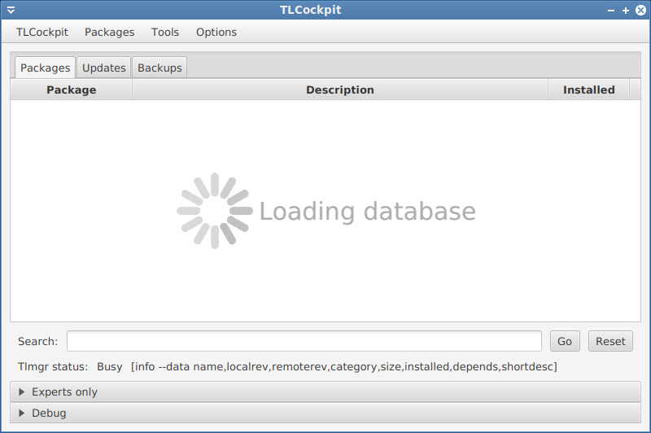

Package listing

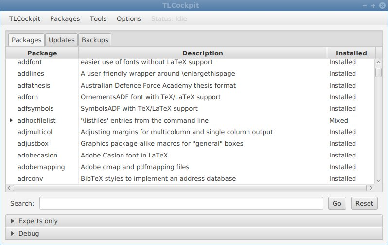

View packages by collections

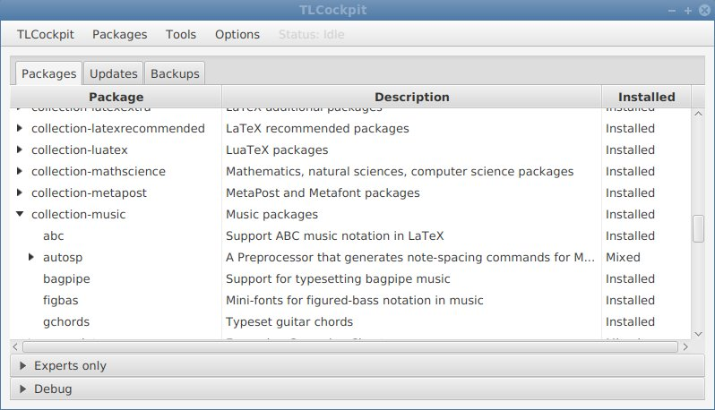

Updates listing, with one package being updated

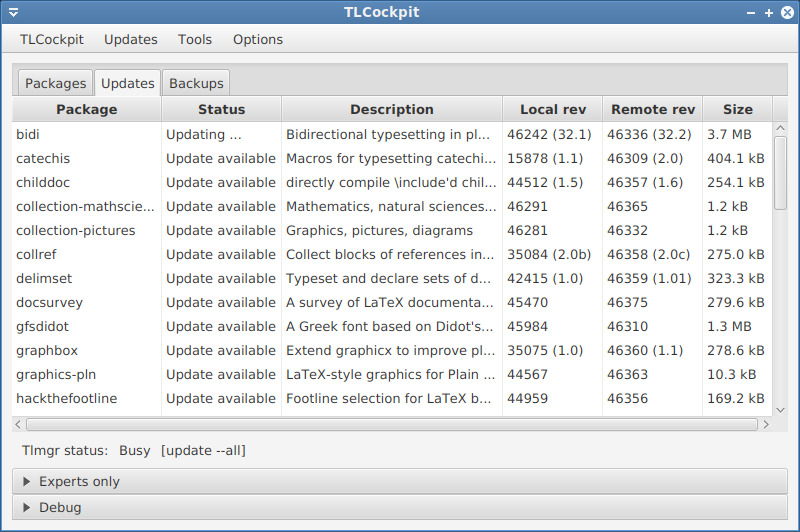

After updating all packages during the run of postactions like `mktexlsr`

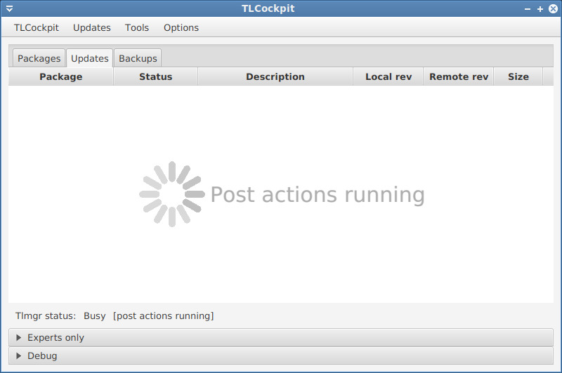

Backup/Restore listing

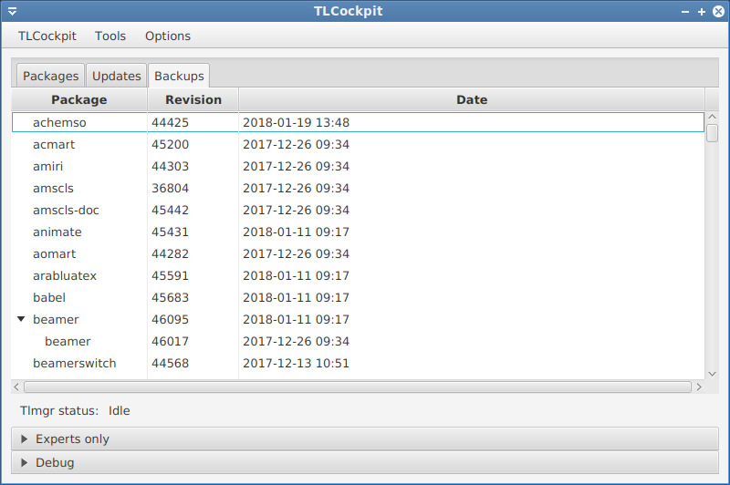

Package details

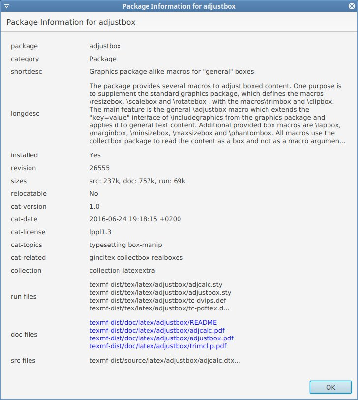

Configuration dialog

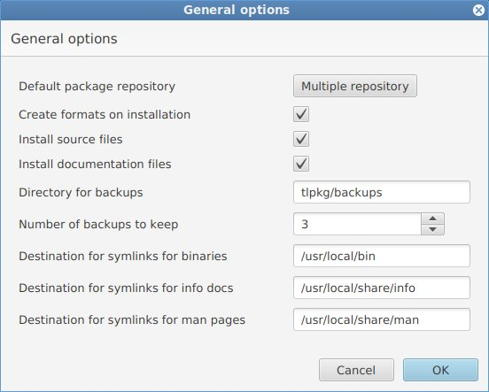

Repository seup dialog with dropdown for mirror selection

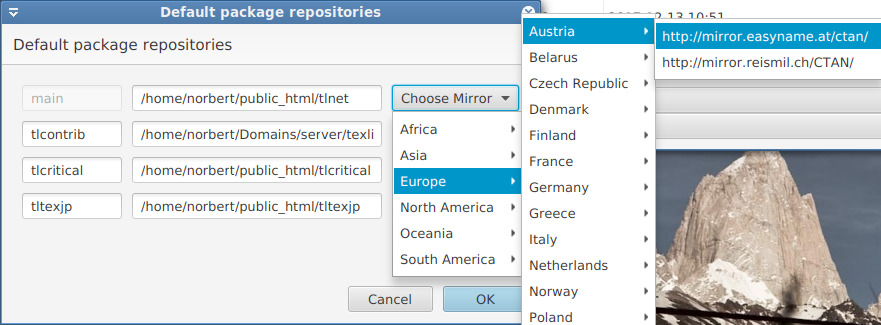

Paper setting dialog

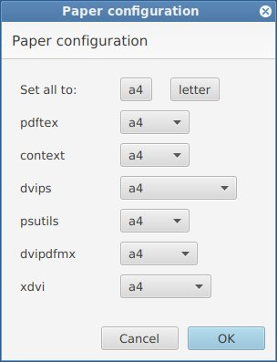

The Tools menu, as well as the expert and debug panes open

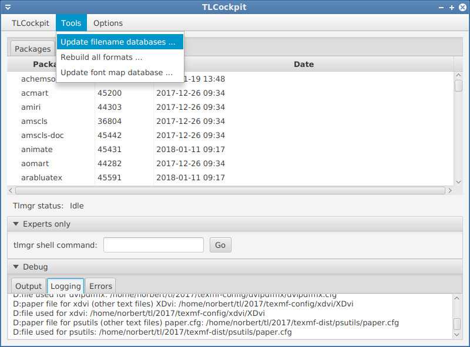

Copyright and License
---------------------

Copyright 2017-2026 Norbert Preining
Licenced under the GNU General Public License, version 3 or any higher version
(GPL3+)

Contributor Code of Conduct
---------------------------

This project adheres to No Code of Conduct. We are all adults. 
We accept anyone's contributions.  Nothing else matters.

For more information please visit the [No Code of Conduct](https://nocodeofconduct.com) homepage.

Author
------

Norbert Preining

